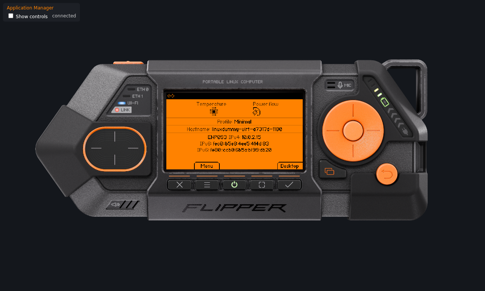
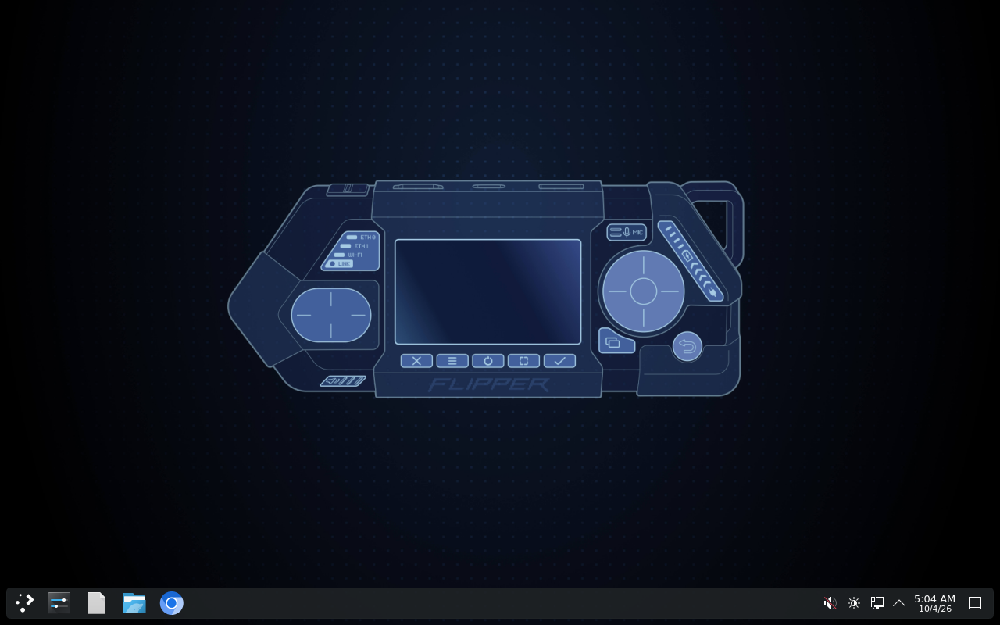
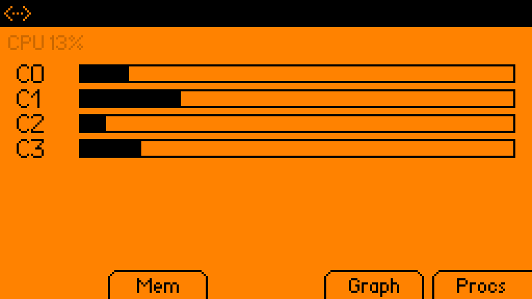

# Flipper One VM

Runs the official Flipper One firmware image (FlipperOS = Debian 13 arm64, nightly
build **2315**, 2026-10-03, `flipper-one` target from dl-linux-images.flipp.dev) on this
Intel Mac under QEMU. There is no official VM; this is a home-made one.

## Screenshots

| Flipper One front panel | KDE desktop | sysmon panel |
|---|---|---|
|  |  |  |

The front-panel UI (`flipctl`) is served live at http://localhost:8899.

## Use it

```sh
cd ~/FlipperOneVM
./run.sh                 # KDE desktop in a window (or double-click "Flipper One VM.command")
./run.sh No-Graphics     # other boot-menu profiles: Minimal, No-Graphics, TV-Media-Box, Router
./run.sh --headless      # serial console in the terminal, no window (Ctrl-A X quits)
./run.sh --background    # detached; then ./ssh.sh
./ssh.sh                 # log in (user / user, has sudo)
./ssh.sh sudo poweroff   # clean shutdown (closing the window = pulling the plug)
./run.sh --reset         # wipe all changes, back to the factory image
```

- **Flipper One screen:** http://localhost:8899 — the device's real front-panel UI
  (`flipctl`), live. Click the buttons on the photo or use arrows / Enter / Backspace /
  Tab / Z X C V B.
- **Profiles tested:** Desktop and No-Graphics boot fine. Minimal should too. Router and
  TV-Media-Box are untested: Router's NetworkManager config may not bring up the VM's
  network (so no SSH; use `--headless` for the serial console), and Kodi on
  TV-Media-Box likely needs real GL.
- **Speed:** every arm64 instruction is emulated on the Intel CPU. Boot to the
  desktop takes ~4–5 min (the first boot of each profile adds ~1 min); KDE is usable
  but sluggish. Headless profiles are much lighter.

## VMware version

`vmware/Flipper One.vmwarevm` — double-click it (VMware Fusion). It opens straight
onto the Flipper One device: a boot splash on its screen, then the live UI with
clickable buttons; the console follows the Fusion window size.

VMware on an Intel Mac can only run x86 guests, so this is a small Debian 13 x86 VM
(user / user) that runs the same arm64 emulation inside it (QEMU, `flipper-vm`
service) on the Flipper image, which is its second disk. Same speed or a little
slower than `run.sh`; ~1.5 min to the Flipper UI (first boot of a profile ~3 min). It boots the **Minimal** profile
(no KDE); change `PROFILE` in `/etc/default/flipper-vm` inside it.

- `vmware/ssh.sh` — shell on the Debian VM. The Flipper itself: `ssh -p 2222
  user@<VM IP>`, and its screen is also at `http://<VM IP>:8899/` from the Mac
  (`vmware/ssh.sh hostname -I` prints the IP).
- Reset: revert to the **Factory** snapshot in Fusion.
- Shut it down from Fusion (Virtual Machine ▸ Shut Down); that powers the Flipper
  off cleanly first.
- Don't run it and `run.sh` at the same time unless you like waiting — both
  emulate on the same 4 cores.
- `vmware/payload/` holds what was installed into it (service, kiosk, splash page).

## Apps & device functions

- **Utilities** (Apps › Utilities on the Flipper): Clock (clock/stopwatch/timer),
  Calculator, Commands (system info), Notes (on-screen keyboard, kept in ~/Notes),
  QR Code. Sources in `apps/src/`; push them with `apps/install.sh` (VMware Flipper)
  or `apps/install.sh --local` (the run.sh one). Python apps take ~5-10 s to open
  under emulation; one that hasn't drawn after 10 s is parked — open it again.
- **App Manager** (on the device) installs Flipper's official catalogue apps. Skip
  Doom: emulated, it eats two cores and the whole VM feels frozen.
- **Boot Menu** switches profiles with a soft-reboot (about 1.5 min). The VMware
  version has no display for Desktop / TV-Media-Box, so those say "no kernel".
- **Testing › flipctl2** is a no-op in the VM (the prototype it hands over to needs
  the real panel); the UI comes straight back.
- `scripts/panel.py` grabs the panel as a PNG or presses keys, e.g.
  `python3 scripts/panel.py --host <VM IP>:8899 shot panel.png`.

## Developing for Flipper One

- **Dev profile** (`@Dev`, a clone of Desktop, so KDE included): the on-device toolkit
  lives here — compilers & build systems, gdb/strace/valgrind/perf, Python dev, Rust,
  device-tree / I2C / GPIO / serial tools, kernel headers. Boot it from the Boot Menu.
  Re-run or extend with `sudo flipper-devkit [groups]` on the Flipper
  (`devkit/flipper-devkit.sh`); log in `/var/log/flipper-devkit.log`.
- **`./flipper`** — the dev loop from the Mac (`./flipper help`): `ssh`, `host`, `push`,
  `run` (push + open + screenshot), `logs`, `shot`, `hdmi`, `press`, `build`, `sync`.
- **Build host** — the Debian VM in VMware, native x86 speed (`./flipper host`):
  Rust + aarch64 cross, Flipper's app bundler, the RP2350 firmware toolchain, and
  Flipper's repos in `~/src`. `mcu-build [f1|f2]` builds the MCU firmware `.uf2`;
  `kernel-build` builds their mainline kernel `.deb`s with their own script.
  Re-runnable setup: `./flipper host 'bash -s' < devkit/build-host-setup.sh`. Sources and
  toolchains live on a 40 GB data disk at `/data` (with 4 GB swap): `devkit/build-host-datadisk.sh`.
- **Rust/Slint apps** — keep an app dir like flipctl-slint's `apps/sysmon` (Cargo.toml,
  app.toml, ui/, src/) and `./flipper build path/to/app`: it builds on the host and runs
  on the Flipper.
- **VS Code / ssh** — add `Include ~/FlipperOneVM/ssh_config` at the top of
  `~/.ssh/config` for `flipper-one` (the device), `flipper-build` (the host) and
  `flipper-local` (the run.sh VM).

Where upstream work happens (all on github.com/flipperdevices): `flipperone-linux-build-scripts`
(images, kernels, overlays), `flipper-linux-kernel`, `flipperone-mcu-firmware` (RP2350),
`flipperone-mcu-protobuf` (MCU⇄CPU RPC), `flipctl-slint` (panel UI + app SDK),
`flipctl-apps` (App Manager catalogue), `flipperone-testing`, `flipperone-docs`. Their
help-wanted list: https://docs.flipper.net/one/open-tasks — and a community index:
https://github.com/hypery11/awesome-flipper-one

## How it works

- `qemu/` — QEMU 11.1.2 built from `downloads/qemu-11.1.2.tar.xz` (deps from conda-forge in `env/`;
  the binary links to `env/lib`, so don't move or delete `env/`).
- `images/flipper-one-2315-factory.qcow2` — the untouched image, grown to 32 GiB
  (read-only); `images/flipper-one.qcow2` — your changes on top of it.
- The image's own kernels (7.3-rc mainline / 6.1 BSP) only drive RK3576 hardware, so
  the VM boots **Debian's 6.12 arm64 kernel** (`kernel/`) with a tiny busybox
  initramfs (`scripts/init`, built by `scripts/build-initramfs.py`). It mounts
  `rootflags=subvol=@<Profile>` like the real boot entries, and on a profile's first
  boot unpacks the kernel's modules into it from the read-only `kernel/modules.tar` disk.
- VM-only tweaks are written to a tmpfs `/run` at boot (nothing on disk changes):
  `flipctl --headless` instead of driving the SPI panel; KWin on QPainter and Qt
  Quick's software backend (the image's Mesa only has softpipe); USB-gadget and
  repart services masked.

## What doesn't work

Anything that needs the real board: Wi-Fi/BT/cellular radios, the RP2350 MCU
(buttons, LEDs, power), GPIO/SPI/I2C, the GPU, USB gadget mode, audio. The front-panel
UI runs only as the browser view. Logging out of KDE hands the screen to the SDDM
greeter, which doesn't get the software-rendering tweak and will likely stay black;
use `./ssh.sh sudo reboot` instead.

## Newer builds

Images appear at https://dl-linux-images.flipp.dev/full-img/ (manifest.json per build).
To switch: download `debian-512-flipper-one-<N>.img.zst`, decompress with
`env/bin/zstd -d`, run `python3 scripts/grow-gpt.py  32`, convert with
`qemu/bin/qemu-img convert -O qcow2`, then point `FACTORY` in `run.sh` at it and run
`./run.sh --reset`.
